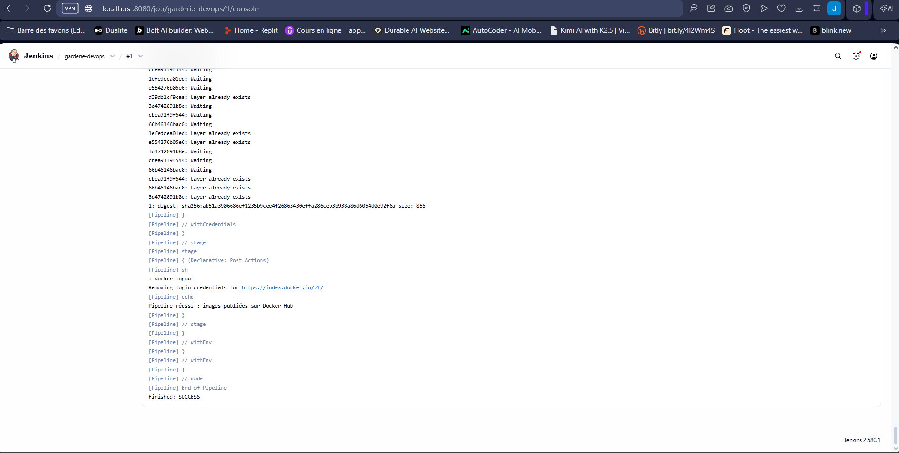
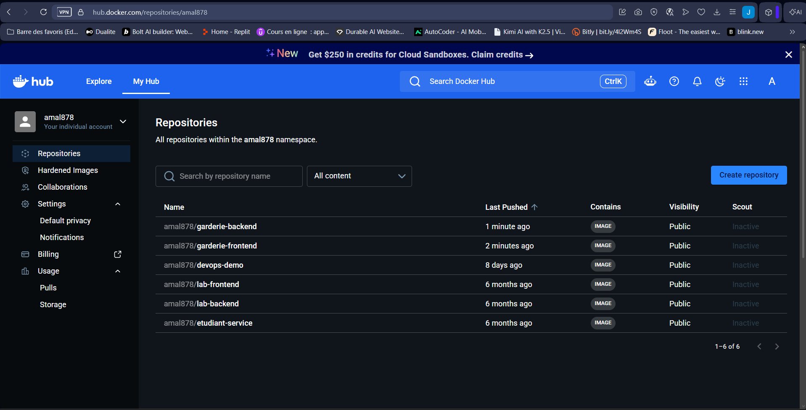
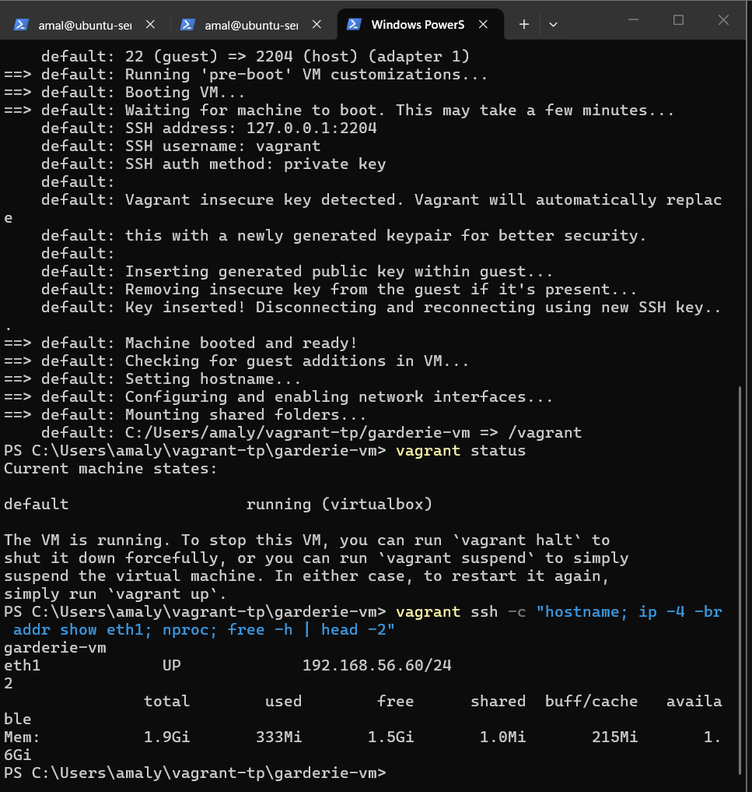
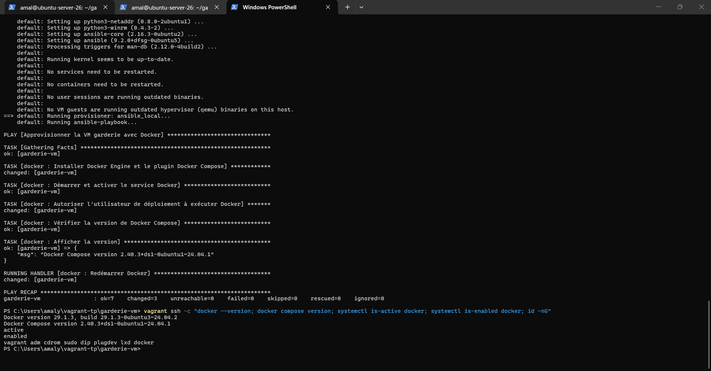
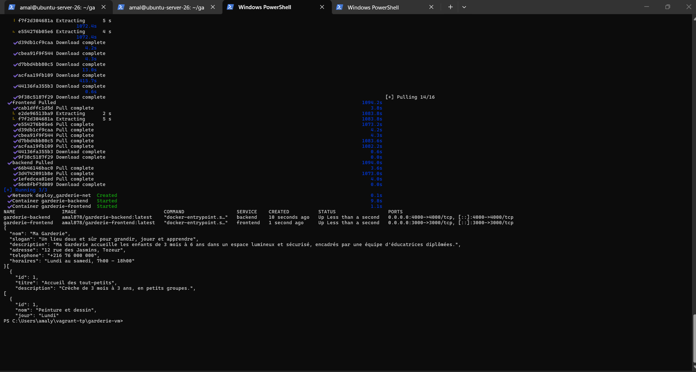
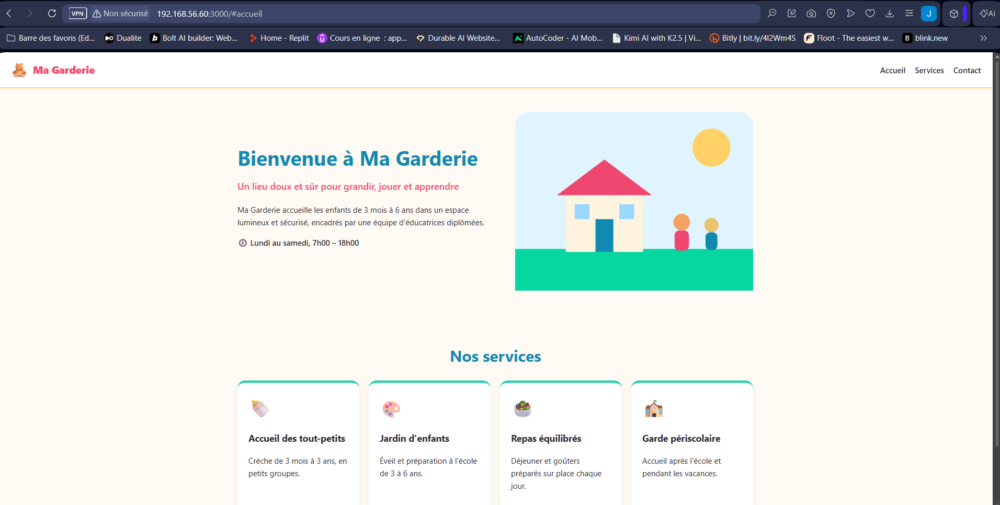

# Ma Garderie – Chaîne CI/CD Jenkins, Docker, Vagrant et Ansible

**Étudiante :** Amal Jemli – Master DevOps & Cloud
**Dépôt :** https://github.com/Amal356/garderie-devops

## 1. Présentation

Landing page responsive d'une garderie d'enfants (Navbar, Hero, Services), alimentée par une API REST.

| Partie | Technologies |
|---|---|
| Frontend | Next.js 16 (App Router), React 19, CSS responsive |
| Backend | Node.js 22, Express 5 |
| Test | Vitest (vérifie le titre « Ma Garderie ») |
| Conteneurs | Docker (multi-étapes), Docker Compose |
| CI/CD | Jenkins (Pipeline as Code), Docker Hub |
| Infrastructure | Vagrant + VirtualBox, Ansible (rôle `docker`) |

API : `GET /api/garderie`, `GET /api/services`, `GET /api/activites`.

## 2. Architecture

~~~
garderie-devops/
├── frontend/            # Next.js : components/ (Navbar, Hero, Services), app/, tests/, Dockerfile
├── backend/             # Express : src/server.js, src/data.js, Dockerfile
├── docker-compose.yml   # build local des 2 images + réseau garderie-net
├── Jenkinsfile          # pipeline CI/CD
├── Vagrantfile          # VM Ubuntu Server (2 Go, 2 vCPU, 192.168.56.60)
├── ansible/             # inventory.ini, site.yml, roles/docker
├── deploy/              # docker-compose.yml avec les images Docker Hub
└── screenshots/
~~~

Chaîne CI/CD :

~~~
GitHub -> Jenkins : Checkout -> Install -> Test -> Build Frontend -> Build Backend -> Push Frontend -> Push Backend -> Docker Hub
Windows -> vagrant up -> VM garderie-vm -> Ansible (rôle docker) -> docker compose pull / up (images Docker Hub)
~~~

Le frontend appelle l'API côté serveur via `API_URL=http://backend:4000` (nom du service sur le réseau Docker `garderie-net`).

## 3. Lancer en local avec Docker Compose

~~~bash
docker compose up -d --build
# http://localhost:3000 (frontend)   http://localhost:4000/api/services (API)
~~~

## 4. Pipeline Jenkins

1. Identifiants Docker Hub : *Gérer Jenkins > Credentials*, type *Username with password*, ID `dockerhub-credentials` (jeton d'accès Docker Hub, jamais dans le code).
2. Job **Pipeline** > *Pipeline script from SCM* > Git `https://github.com/Amal356/garderie-devops.git`, branche `*/main`, Script Path `Jenkinsfile`.
3. **Lancer un build**.

Si le test échoue, `npm test` renvoie un code d'erreur : les étapes Build et Push ne s'exécutent pas.

## 5. Images Docker Hub

- https://hub.docker.com/r/amal878/garderie-frontend
- https://hub.docker.com/r/amal878/garderie-backend

## 6. VM et provisioning

~~~powershell
vagrant up          # VM Ubuntu 24.04, 2 Go RAM, 2 vCPU, IP 192.168.56.60
vagrant ssh         # accès SSH
vagrant provision   # installe Ansible puis exécute ansible/site.yml (rôle docker)
~~~

Le rôle `docker` installe Docker Engine et le plugin Compose, démarre et active le service, et ajoute l'utilisateur `vagrant` au groupe `docker`. Ansible ne fonctionnant pas sous Windows, Vagrant utilise le provisioner `ansible_local` (Ansible s'exécute dans la VM).

## 7. Déploiement dans la VM

~~~bash
vagrant ssh
cd /vagrant/deploy
docker compose pull      # images Docker Hub, aucun build local
docker compose up -d
docker compose ps
curl http://localhost:4000/api/garderie
~~~

## 8. Accès à l'application

**http://192.168.56.60:3000** (depuis une autre machine du réseau)

## 9. Captures d'écran

### Pipeline Jenkins réussi

### Images publiées sur Docker Hub

### VM démarrée avec Vagrant

### Playbook Ansible exécuté avec succès

### Conteneurs en cours d'exécution

### Application dans le navigateur d'une autre machine

